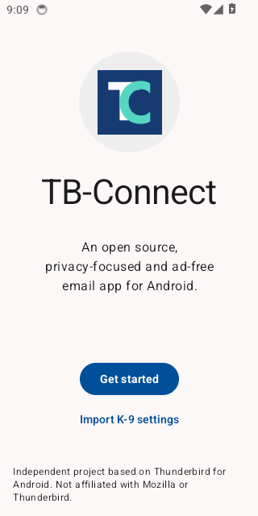

# TB-Connect · Kalender, Tagesplaner und Mail

Kalender übersichtlich darstellen, Aufgaben und vorgemerkte Mails planen, Nachrichten ablegen und ausgewählte Daten zwischen Thunderbird Desktop und Android austauschen.

| Bestandteil | Version | Plattform |
| --- | --- | --- |
| [Kalender Raster](addons/calendar-raster/README.md) | 1.4.30 | Thunderbird Desktop |
| [Tagesplaner](addons/daily-planner/README.md) | 2.0.11 | Thunderbird Desktop |
| [Mail-Ablage nach Adresse](addons/mail-address-filer/README.md) | 1.4.3 | Thunderbird Desktop |
| [TB-Connect Modul-Hub](addons/mobile-module-bridge/README.md) | 2.0.32 | Thunderbird Desktop, optionaler Geräteabgleich |
| [TB-Connect Android](apps/thunderbird-mobile/TB_CONNECT.md) | 2.0.61, Produktionskandidat | Android |

Die Android-App und ihr vollständiger Quellcode gehören zu diesem Projekt. **Der Release wird vorbereitet; noch keine öffentliche stabile Binärfreigabe.** [Status, geprüfte Funktionen und offene Freigabeschritte](docs/RELEASE.md). Pakete werden gemeinsam unter [GitHub Releases](https://github.com/MarcSchlicker/ThunderbirdAddons/releases) angeboten, sobald sie freigegeben sind. Ein Store-Eintrag ist damit noch nicht verbunden.

## Installation und Nutzung

Für Desktop ist Thunderbird 128 die Mindestversion der Manifeste; das ist keine Zusage, dass jede neuere Version bereits getestet wurde. Jede Erweiterung lässt sich einzeln verwenden. XPIs über **Add-ons und Themes → Zahnrad → Add-on aus Datei installieren** öffnen. Die enthaltenen Experiment-Schnittstellen benötigen weitreichenden Zugriff auf Thunderbird und den Computer.

- [Kalender, Personen, Farben und Filter](addons/calendar-raster/BEDIENUNG.md)
- [Aufgaben und Mails planen](addons/daily-planner/BEDIENUNG.md)
- [Adressbezogene Mail-Ablage](addons/mail-address-filer/BEDIENUNG.md)
- [Android: Einrichtung und Build](apps/thunderbird-mobile/TB_CONNECT.md)
- [Datenwege und Datenschutz](docs/PRIVACY.md)

Der Kalender bietet Tag, Woche, Monat, Stundenraster und konfigurierbare Personen. Der Tagesplaner bündelt Aufgaben, Notizen, Termine und Mailverweise. Die Ablage verschiebt Nachrichten erst nach einer bewussten Aktion. Der optionale Hub verbindet Desktopmodule und App; die mobile Verbindung verwendet natives TLS mit exakter Zertifikatbindung, lokale Desktopadapter sind auf Loopback begrenzt. [Transport und Gerätefreigabe](docs/HUB_TLS.md). Google- und Android-Kalender benötigen eigene Berechtigungen; Desktop-Anmeldungen werden nicht auf das Handy kopiert.



## Entwickeln

Node.js 22+, für die XPI-Pakete Windows mit PowerShell und tar.exe:

```powershell
npm ci
npx playwright install chromium
$env:PW_BROWSER_CHANNEL = 'chromium'
npm test
node scripts/check.cjs
./scripts/prepare-release.ps1
```

Die Paketvorbereitung baut vier normale XPIs nach `dist/`, prüft Lizenz und Diagnosekennung und erzeugt SHA-256-Prüfsummen. Sie veröffentlicht und installiert nichts. Nur Namen mit Präfix `test_` aktivieren die Diagnose in den drei dafür ausgestatteten Add-ons; normale Pakete bleiben deaktiviert. [Diagnose](docs/DIAGNOSTICS.md).

Android hat einen eigenen [signierten Produktionsbuild](docs/ANDROID_RELEASE.md) mit der Paketkennung eu.mschlicker.tbconnect. Der eigene Google-Client ist registriert und im Kandidaten konfiguriert; Gmail-Bereich ist deklariert; öffentliche Anbieterfreigabe und reale Geräteabnahme sind noch offen. Signierschlüssel, Konten, lokale SDK-Pfade und persönliche Prüfprotokolle sind nicht enthalten. Der öffentliche Quellcode ist ein bereinigter Snapshot; private Entwicklungshistorie wird nicht übernommen. [Veröffentlichung in Thunderbird und Android](docs/DISTRIBUTION.md).

## Lizenz und Kontakt

Desktop-Erweiterungen: **MPL 2.0**, wie Thunderbird Desktop. Android: **Apache 2.0**, wie Thunderbird für Android. Fremdlizenzen bleiben erhalten; [Details](LICENSING.md). Fehler bitte über [Issues](https://github.com/MarcSchlicker/ThunderbirdAddons/issues) mit Version und Reproduktionsschritten melden, ohne Nachrichten, Kontodaten oder Zugangsdaten.

TB-Connect ist unabhängig und kein offizielles Mozilla- oder Thunderbird-Produkt.

Der Planer2.0.11 verwendet für mobile Verbindungen den TLS-Hub. Der frühere direkte Handy-LAN-Dienst ist abgeschaltet; vorhandene Planerdaten und Zugangsdaten bleiben erhalten. [ATN-Vorprüfung und Datenschutztexte](docs/ATN_SUBMISSION.md).
